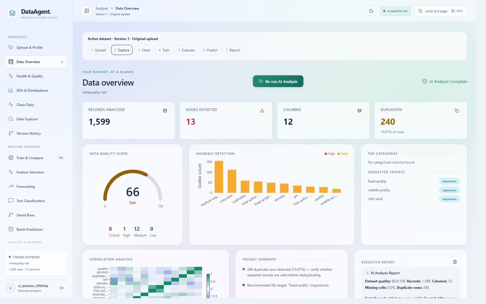

# Autonomous Data Science Agent

A local data analysis application with React and Streamlit interfaces, deterministic
statistics, LLM-written interpretations, supervised AutoML, prediction, and PDF /
PowerPoint reports. The code computes statistics before sending evidence to an
LLM, but generated interpretations still require review. This repository does not
provide a production certification or a guarantee that reports contain no errors.

## Generative AI project report

**Data Agent: An Integrated Platform for Conversational Analytics and Automated
Machine Learning** is documented in the accompanying 17-page academic report.
It covers the implemented architecture, analytical workflows, model evaluation
and limitations, with seven desktop screenshots of the red-wine quality dataset.
Two landscape pages provide larger dashboard and distribution views. The cover
places the student details above the faculty guidance section.

- [Read the project report (PDF)](output/pdf/Data_Agent_Generative_AI_Report.pdf)
- [Download editable LaTeX source and images (ZIP)](output/pdf/Data_Agent_LaTeX_Source.zip)
- [View the LaTeX source](output/pdf/Data_Agent_Generative_AI_Report.tex)



The academic report is built separately with LaTeX. The application's Report
Builder generates its own dataset-specific PDF and PowerPoint exports. See the
README inside the source archive for the academic report's build commands.

## Setup

Use Python 3.11 or newer and Node.js for the React interface. The regression suite
has been exercised with the project's Python 3.13 virtual environment.

```powershell
python -m venv .venv
.venv\Scripts\python.exe -m pip install -r requirements.txt -r requirements-dev.txt
Copy-Item .env.example .env
```

Configure only the provider keys you use in `.env`. Groq key slots are
`GROQ_API_KEY_1` through `_11`; NVIDIA slots are `NVIDIA_API_KEY_1` through `_7`.
These are maximum configuration slots, not 18 provisioned accounts or available
quotas. Model names and routing defaults are defined in `backend/config.py`;
provider access and availability depend on your account. Without working provider
credentials, deterministic profiling works and narrative calls return an
unavailable-service notice or the calling agent's fallback.

```powershell
.venv\Scripts\python.exe -m uvicorn backend.main:app --host 127.0.0.1 --port 8000 --workers 1
```

Open `/docs` on that backend for the generated API schema. Register/sign in through
an interface. Application routes require a bearer token, and project routes verify
ownership. `AUTH_ALLOW_REGISTRATION=false` disables new registrations. A blank
`JWT_SECRET_KEY` creates a persistent local signing key; configure a private random
secret for a server. See `.env.example` for JWT lifetime, CORS and execution limits.

React:

```powershell
cd frontend_web
npm install
npm run dev
```

The dev server uses port 5173 and proxies `/api` to port 8000. For a separately
hosted backend, copy `frontend_web/.env.example` to `frontend_web/.env`, set
`VITE_API_URL` before `npm run build`, and allow the frontend's origin in backend
`CORS_ORIGINS`. Training, prediction, polling and downloads share this API client.

Streamlit, from the project root:

```powershell
.venv\Scripts\python.exe -m streamlit run frontend/app.py --server.port 8501
```

Set `BACKEND_URL` for sample API calls. Streamlit imports backend services directly
for local analysis/chat and must share the same filesystem, database and signing
configuration. It is not a fully remote API-only client.

## Implemented behavior

| Area | Current implementation |
| --- | --- |
| Ingestion | UTF-8/BOM, BOM UTF-16/32 and Windows-1252 CSV, XLSX and XLS uploads. CSV detects comma, semicolon, tab or pipe delimiters and decimal commas in non-comma exports. Ragged records and binary/control characters are rejected. Synthetic samples contain 600 rows, complete profiles and authenticated full CSV downloads. |
| Profiling and cleaning | Column roles, missingness, duplicate checks, distributions, Pearson correlations, outlier flags and a heuristic health score. Cleaning uses unique names and protects a selected target; without a target it defers learned imputation/clipping. No fixed runtime guarantee. |
| Analysis | Eleven node functions: loader, supervisor, schema, quality, KPI, EDA, diagnostic, hypothesis, trend, visualization and report. `run_analyst_pipeline` executes dependency-ordered stages using thread pools. A separate compiled sequential LangGraph is available, but API analysis uses the stage executor. |
| Statistics | Welch, Mann-Whitney, ANOVA and chi-square tests with input checks, effect sizes and Holm family correction; Pareto crossings and segment concentration; monthly aggregates, tie-corrected Mann-Kendall and STL. Correlation outputs are Pearson/Spearman, not mutual information. |
| AutoML | Classification and regression with per-fold preprocessing, random/grouped/chronological splits, CV-based model selection/tuning, a simple holdout baseline, confusion matrices/residuals and poor-performance warnings. Models are saved per run. Macro F1 is the classification primary metric; weighted F1 is separate. |
| Model catalog | Logistic Regression, Decision Tree and Random Forest classifiers, with XGBoost/LightGBM/CatBoost when installed (Gradient Boosting fallback for missing CatBoost). Regression: Linear, Ridge, Lasso, Random Forest, and optional XGBoost/LightGBM. Per-model failures are returned. |
| Tuning and explanations | Optuna applies suggested parameters and retains a tuned candidate only when CV supports it. Feature importance attempts SHAP for supported trees and falls back to permutation/model importance. Percentages are normalized importance scores, not causal attribution or a percentage of an outcome explained. |
| Chat | LLM-generated analytical expressions run through a restricted interpreter in a disposable subprocess with timeout/memory/CPU limits. It supports a limited pandas vocabulary, not arbitrary Python. React chat lives above page navigation and is saved in project snapshots. |
| Reports | Markdown, local ReportLab PDF and python-pptx exports, with authenticated downloads and explicit artifact availability. A failed export is not advertised as a working download. |
| Interfaces | React: upload, overview, quality, EDA, cleaning, linked explorer, versions, Train & Compare/what-if, forecasting, text classification, saved runs, insights, chat, report builder and executive reports. Streamlit: upload/audit, health/KPIs, hypotheses, charts, chat, briefing, dataset comparison. |


## Versioned React workspace

**Clean Data** previews explicit sentinel replacement (for example `-200`), type
conversion with explicit date formats, whitespace trimming, category case/mapping,
constant missing-value replacement or row removal, column removal/renaming and
duplicate removal. Save owner-scoped recipes and preview them against other files.
The preview lists the first 100 cell/row changes with reasons; download the full
CSV audit before applying. Applied versions retain the audit for later download.
Conversion errors require an explicit choice to turn invalid values into missing
values. A selected target is protected from replacement, conversion, renaming and removal.
The default editor uses observed-value checkboxes, type-aware replacement choices,
readable date-format dropdowns and category-to-category selectors. Optional custom
values, JSON mappings and column changes are collapsed under Advanced options.
Placeholder suggestions are opt-in; the preview moves into view on smaller screens.
Apply creates an immutable version; undo activates its parent. **Version History**
compares rows, columns, heuristic quality scores, transformation steps and model
runs, and downloads individual versions. Original uploads stay preserved.
Explicit cleaned versions are used by the explorer, modeling and reports.
Imputation and scaling for supervised models still fit within training folds.

**Data Explorer** searches all columns, sorts and pages on the server, supports
value/missing/numeric filters, and cross-filters its category chart, histogram,
table and summary statistics when a bar is clicked. Clear individual filter chips
or clear all filters to return to the whole dataset.

The persistent header identifies the active version. The workflow guide links
**Upload → Explore → Clean → Train → Evaluate → Predict → Report** and warns when
saved runs belong to other versions. Changing data clears derived current results
while retaining version-bound experiment history.

The **Machine Learning** menu contains:

- **Train & Compare:** random, grouped or chronological holdout and corresponding
  validation folds. Group IDs and split dates are excluded from features. Equal
  timestamps never cross a chronological boundary. Baselines use the training
  mean or most frequent class. Holdout does not select or tune the winner.
- **Feature Selection:** inspect only the training partition for possible IDs,
  exact target copies and near-perfect target correlations; include/exclude eligible
  raw columns. Automatic selection ranks encoded features inside each training
  fold, after fold-specific imputation/encoding. An optional comparison uses the
  same estimator and training folds before/after selection. Manual choices based
  on repeated evaluation can still overfit; flags cannot detect every leakage path.
- **Forecasting:** daily, weekly, monthly, quarterly or yearly aggregation;
  explicit mean/sum selection; reject gaps or causally forward-fill them. Choose
  2–10 backtest windows (React default 6). Earlier windows select among seasonal
  naive, last-value and additive exponential smoothing; later windows estimate
  interval widths; one additional final horizon measures untouched holdout error
  and interval coverage. Four or more backtest windows allow separate calibration.
  With only two windows, intervals reuse selection errors and disclose this limit.
  Bands remain **approximate**, with horizon-specific absolute errors, observation
  counts and low-coverage warnings. Imputed outcomes are excluded from scores.
  At least `max(12, 2 * season_length) + (backtest_windows + 1) * horizon` periods
  are required. Limits: 5,000 periods per series, horizon 60, season length 52,
  and 20 named series. Series fit independently; failed series are listed and
  excluded from equal-weight aggregate MAE. There is no hierarchical reconciliation.
- **Text Classification:** TF-IDF unigrams/bigrams with Logistic Regression and
  Multinomial Naive Bayes, macro-F1 model selection, per-class evaluation,
  confusion matrices, misclassified holdout messages and prediction of new text.
  Normalized duplicate messages stay in the same partition/fold. At least 30
  labeled messages, 2–30 classes and ten distinct messages per class are required.
- **Batch Prediction:** upload CSV/Excel against a saved tabular or text model.
  Missing required columns and invalid numeric values are rejected; extra columns
  are retained. Preview the first 100 rows and download the entire prediction CSV
  (up to 10,000 rows). Older-version models require deliberate selection. Optional
  binary thresholds change decisions without changing model probabilities.
  New tabular models provide per-row feature sensitivity by replacing one feature
  with its training median/mode; these are not additive SHAP or causal explanations.
- **Saved Runs:** side-by-side comparison of up to four runs, including version,
  metric, split, selected features, baseline and warnings. Matching metric names do
  not make different versions or split settings directly comparable. New tabular
  and text classification runs include precision–recall curves, Brier scores,
  reliability diagrams and binary threshold exploration. Probabilities are clearly
  labeled uncalibrated; diagnostics do not fit a calibration transformation.
  Threshold exploration reuses holdout data and is not independent evaluation.
  Older models need retraining for diagnostics requiring saved holdout predictions.
  Runs retain settings, version, diagnostics and separate model artifacts.
  Forecast runs retain their forecast and backtest results rather than a joblib
  inference artifact. New text/forecast jobs use the existing persistent bounded
  job queue and survive page navigation. Interrupted running jobs after a server
  restart are marked failed and can be submitted again.

**Report Builder** selects up to twelve evidence charts, edits context/commentary,
sets title/organization/accent color, previews the result, exports PDF/PowerPoint,
and saves owner-scoped templates. Distribution and missingness charts are
available without LLM analysis. Supported exported chart types are bar, histogram,
line/scatter, heatmap, raw-sample box and pie. Unsupported chart encodings return
an explanation rather than silently omitting the chart. Templates reused with
another dataset require reviewing chart choices. The workspace currently allows
20 immutable versions, 100 saved runs and 20 prediction batches per project, and
30 templates and 30 cleaning recipes per user. Change audits allow up to 400,000
entries and 10 MB compressed per version. Prediction batches have a separate
per-user compressed-storage quota (100 MB by default).
Version frames have a 100 MB default per-user compressed-storage quota, separate
from the existing session snapshot quota.

These workflows are in the React interface and authenticated `/api/workspace`
routes. Streamlit retains its existing analysis/cleaning/model screens.

Analysis stages run schema before quality; KPI and EDA can run together; diagnostic
follows; hypothesis and trend can run together; visualization follows trend and
report follows visualization. The supervisor can skip optional agents. Branch
warnings/errors are retained in the shared response. Progress reports actual
stages and model candidates; percentages are estimates of stage completion, not
remaining time.

Tests are exploratory and assume independent observations. A p-value is not the
probability that a conclusion is true or due to chance. Non-rejection of normality
does not prove normality. Outlier agreement means the same observations were
flagged by both rules; flags alone do not establish errors. Recurring seasonality
requires two complete annual cycles and adequate estimated STL strength. Missing
months remain gaps. Reference benchmarks require exact metric names, units and
periods; historical reference values are unverified and do not establish an
industry percentile.

## Storage, limits and recovery

SQLite at `DS_AGENT_DB_PATH` (default `ds_agent.db`) is the ownership authority and
stores users, sessions, projects, reports/chat metadata, experiments, durable
compressed dataset snapshots and job descriptors/results. Models and generated
files live under `artifacts/`, `reports/` and `charts/`. With
`ENABLE_CLOUD_SYNC=true` and server credentials, R2 uploads and selected Supabase
metadata mirrors are attempted. Cloud synchronization is not a replacement for
local durable storage; experiment history is local SQLite, not a Supabase mirror.

Run **one API process** (`--workers 1`). Three default worker threads serve at most
12 queued/running jobs globally, three per user and one per project. Queued
analysis/AutoML jobs resume at startup; interrupted running jobs are retained as
failed with a retry message. Terminal job history is pruned at startup/submission
to 200 records or seven days. React remembers the selected project in browser
session storage and restores saved analysis, chat, AutoML results and pending
polling after reload. New dataset selection clears derived state and rejects late
responses from previous projects/jobs.

| Configurable limit | Default |
| --- | --- |
| Upload bytes | 10 MiB, with a separate multipart body allowance |
| Dataset dimensions | 100,000 rows; 128 columns; 2 million cells |
| Decoded dataframe / expanded Excel size | 100 MiB |
| In-memory dataset session cache | Eight projects, with reload from SQLite |
| Stored sessions per user | 20 projects / 100 MiB compressed snapshots |
| Analytical Python subprocess | 15 seconds / 512 MiB, plus expression/input/output limits |

Oversized uploads return 413; session/job admission returns 429. Pending projects
cannot be cleaned or removed (409). Removing a project frees stored-session quota
and metadata; generated files remain on disk and need separate retention. Settings
and exact variable names are in `.env.example`; implementation details and earlier
fixes are in [FIXES.md](FIXES.md).

## Key monitoring and dataset versions

`GET /api/keys/health` reads the same Gemini, Groq and NVIDIA pools that make
requests in the API process. Active agents pass explicit task names; measured
first/fallback models are in `backend/model_routes.json`. The legacy
`DEFAULT_PROVIDER` applies only to callers without an explicit task. Gemini reads
`Gemini_ApiKey_1` through `Gemini_ApiKey_6`; Groq uses only GPT-OSS 120B in active
routes. See [MODEL_LIST.md](MODEL_LIST.md) and
[MODEL_API_TEST_REPORT.md](MODEL_API_TEST_REPORT.md) for current routes and live evidence.

Each selected key records attempts, successes, failures and cooldowns. One request
per key can run at a time, allowing independent account keys to work concurrently.
Conservative configured per-key ceilings are NVIDIA 40 RPM, Groq 30 RPM and
estimated 8K TPM, Gemini Flash-Lite 15 RPM and Gemini reasoning 5 RPM. These are not
live entitlement checks. HTTP 429 applies at least a 65-second cooldown and honors
numeric Retry-After; 5xx/transport failures apply 15 seconds; 401/403 applies one hour.
Bad/overloaded models switch route without exhausting all accounts. Empty or
truncated answers are rejected; schema and plan outputs require JSON objects.
A health read contacts no provider. Success rate is unavailable before a request.

These are **process-local observations**, not provider billing/remaining quota or
an active credential check. Counters reset after process restart. Calls made by a
separate Streamlit process have its own pools and are not visible in the API's
health response.

Experiments and optional cache helpers share a versioned full-content SHA-256
fingerprint covering every row, exact float values, index, schema and row/column
order. Query keys preserve literal case and whitespace. Old sampled fingerprints
are invalidated by a version tag; historical experiment records keep their original
hashes, and new experiment API results expose `dataset_hash`. Fingerprints identify
inputs; they do not pin dependency versions or guarantee identical training on
all machines.

## API reference

All routes below require authentication except registration/login. Use `/docs`
for request/response schemas and error details.

| Method | Path | Purpose |
| --- | --- | --- |
| POST | `/api/auth/register`, `/api/auth/login` | Account creation / sign-in |
| GET / POST | `/api/auth/me` / `/api/auth/logout` | Current account / revoke current session |
| GET | `/`, `/api/sample-datasets` | Service information / sample catalog |
| POST | `/api/load-sample`, `/api/upload`, `/api/profile` | Create an owned dataset session |
| GET | `/api/profile/{project_id}` | Profile the active analytical view |
| GET | `/api/datasets/{project_id}/download` | Full active CSV |
| GET | `/api/projects`, `/api/projects/{project_id}/session` | Owned projects / restore saved work |
| DELETE | `/api/projects/{project_id}` | Remove owned project/session metadata |
| POST | `/api/clean` | Clean and invalidate derived analysis/model results |
| POST | `/api/analyze`, `/api/analyze/start` | Synchronous analysis / bounded background job |
| POST | `/api/automl/start`, `/api/predict` | Validated training job / saved-model prediction |
| GET | `/api/job/{job_id}/status`, `/api/job/{job_id}/result` | Owned job status / result |
| GET | `/api/models/{project_id}/download` | Saved champion model |
| GET | `/api/reports/{project_id}/{format}/download` | PDF or PPTX artifact |
| GET | `/api/experiments`, `/api/experiments/{project_id}` | Owned experiment history |
| GET | `/api/keys/health` | Local request counters and cooldowns |
| GET | `/api/workspace/{project_id}`, `/api/workspace/{project_id}/workflow` | Versions, runs and active workflow status |
| GET / POST | `/api/cleaning-recipes` | List or save reusable owner-scoped transformations |
| GET | `/api/workspace/{project_id}/clean/options?column=...` | Bounded observed values, placeholder suggestions and readable cleaning choices |
| POST | `/api/workspace/{project_id}/clean/preview`, `/clean/preview-audit`, `/clean/apply` | Preview, download complete proposed changes, apply a version |
| GET | `/api/workspace/{project_id}/versions/{version_id}/audit` | Download recorded cleaning changes |
| POST | `/api/workspace/{project_id}/features` | Assess eligible features using training rows only |
| GET | `/api/workspace/{project_id}/runs/{run_id}/schema` | Saved model input requirements and version status |
| POST | `/api/workspace/{project_id}/runs/{run_id}/batch` | Validated multipart batch prediction |
| GET | `/api/workspace/{project_id}/batches/{batch_id}/download` | Complete saved prediction CSV |
| POST | `/api/workspace/{project_id}/runs/{run_id}/threshold`, `/explain` | Holdout threshold metrics / individual prediction sensitivity |

## Verification

From the root, run the maintained offline suite:

```powershell
.venv\Scripts\python.exe run_regression.py --frontend
```

It uses temporary SQLite storage, blocks provider requests, asserts behavior and
returns a nonzero exit code on Python or frontend failure. Coverage includes
real CSV uploads/training/prediction/report export, auth/ownership, constrained
execution, pipeline dependencies/errors, leakage prevention, target protection,
restarts/limits/state, request-pool health, full-data fingerprints and cache misses.
It does not verify live provider/model availability or visually approve every UI.
For a production frontend build, run `npm run build` in `frontend_web/`.

Local `.env` files, databases, uploads, generated runtime artifacts, downloaded
datasets and document working files are excluded from Git. Synthetic fixtures in
`tests/data/` are included. Five additional CSV checks use optional local files
under `test/` and skip when those downloads are absent from a fresh checkout.
Kaggle checks likewise skip until the datasets are downloaded as described below.

For real Kaggle verification, set `KAGGLE_API_TOKEN` in your private `.env`, then
run `.venv\Scripts\python.exe testing_tools/fetch_kaggle_datasets.py` once.
The bounded downloader saves ten datasets and a source/checksum manifest under
`tests/data/kaggle/`. `tests/test_kaggle_datasets.py` verifies full-file imports,
analyses, exports, model competitions, predictions and ownership offline. These
tests skip explicitly when the downloaded files are absent. It does not tune all
Kaggle competitions; the dedicated tuning tests exercise actual Optuna refits.

The ten-source live browser audit, fixes, evidence and modeling limitations are
documented in [KAGGLE_WEB_TEST_REPORT.md](KAGGLE_WEB_TEST_REPORT.md).

The six historical local scripts (`test_master_suite.py`, `test_all_services.py`,
`test_all_5_datasets.py`, `test_analyst_pipeline.py`, `test_pipeline_3_datasets.py`,
`test_classification.py`) are compatibility entry points to the same offline suite.
They accept pytest arguments and `--frontend`. `pytest.ini` selects `tests/`.

`test_live_api.py` and `test_upload_endpoint.py` remain explicit manual live checks.
They require an existing account in `DS_TEST_USERNAME` / `DS_TEST_PASSWORD` and
optionally `DS_TEST_BASE_URL`. They create records on the selected backend and can
invoke configured providers; they are excluded from the offline suite.

## Limits and historical plans

Unsupervised learning/PCA, causal inference,
distributed workers, measured latency guarantees, live billing quota retrieval,
and an NL-to-SQL product page are not implemented. The SQLite SQL helper and
pickle-based analysis cache are standalone utilities, not integrated API features;
the cache has no LRU bound and must only read trusted local files. No upload path
accepts pickle models. The active API routes do not use DuckDB.

[Autonomous_Data_Science_Agent_Roadmap.md](Autonomous_Data_Science_Agent_Roadmap.md)
and [COMPLETE_NEW_README.md](COMPLETE_NEW_README.md) are historical proposals, not
feature or provider-pricing guarantees. The [folder review](folder_review/PROJECT_REVIEW.md)
is the original assessment; subsequent changes are recorded in [FIXES.md](FIXES.md).

The newer workspace workflows were checked in the live React app; see
[WORKSPACE_FEATURE_TEST_REPORT.md](WORKSPACE_FEATURE_TEST_REPORT.md). Version-linked
Saved Runs records begin with this workflow; older experiment records are not
retroactively assigned to dataset versions.

The latest workflow extensions and live validation evidence are recorded in
[WORKFLOW_IMPROVEMENT_TEST_REPORT.md](WORKFLOW_IMPROVEMENT_TEST_REPORT.md).

Guided cleaning and all six Machine Learning sections were exercised live; see
[ML_CLEANING_TEST_REPORT.md](ML_CLEANING_TEST_REPORT.md) for cases, fixes and evidence.
